<picture>
  <source media="(prefers-color-scheme: dark)" srcset="assets/banner-dark.svg">
  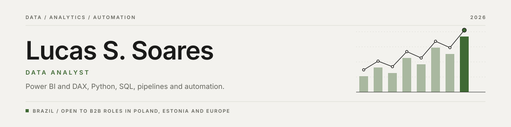
</picture>

Hi, I'm Lucas. I'm a data analyst from Brazil, working at mid-level with Power BI and advanced DAX, Python, SQL and automation. I like the unglamorous part of analytics: making the numbers arrive on time, in the same shape, every day, so people can stop questioning them and start using them.

I'm looking for B2B roles in Poland, Estonia and the rest of Europe.

<picture>
  <source media="(prefers-color-scheme: dark)" srcset="assets/stats-dark.svg">
  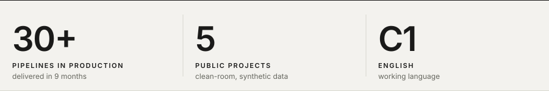
</picture>

## Skills

<picture>
  <source media="(prefers-color-scheme: dark)" srcset="assets/skills-dark.svg">
  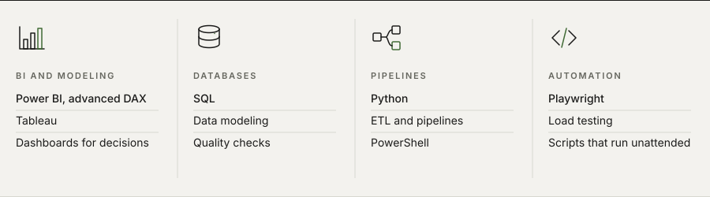
</picture>

## Projects

  <a href="https://github.com/lksuey/ecosys"><picture>
    <source media="(prefers-color-scheme: dark)" srcset="assets/card-ecosys-dark.svg">
    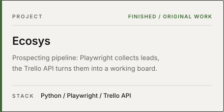
  </picture></a>
  <a href="https://github.com/lksuey/relatorio-supers"><picture>
    <source media="(prefers-color-scheme: dark)" srcset="assets/card-relatorio-supers-dark.svg">
    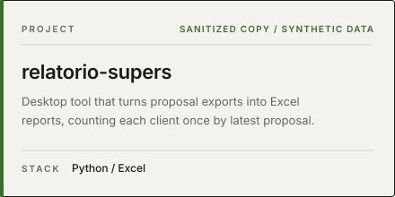
  </picture></a>

  <a href="https://github.com/lksuey/assina-ai"><picture>
    <source media="(prefers-color-scheme: dark)" srcset="assets/card-assina-ai-dark.svg">
    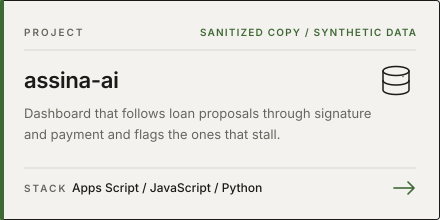
  </picture></a>
  <a href="https://github.com/lksuey/portal-qualidade"><picture>
    <source media="(prefers-color-scheme: dark)" srcset="assets/card-portal-qualidade-dark.svg">
    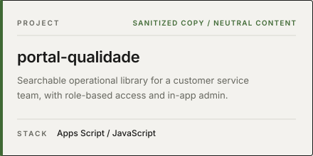
  </picture></a>

  <a href="https://github.com/lksuey/luzia-amelia"><picture>
    <source media="(prefers-color-scheme: dark)" srcset="assets/card-luzia-amelia-dark.svg">
    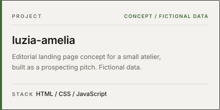
  </picture></a>

Most of my production work lives inside company systems, so I only show what I can publish. Where a project comes from internal work, it is a clean-room rewrite on synthetic data, published with the employer's authorization.

## How I work

<picture>
  <source media="(prefers-color-scheme: dark)" srcset="assets/principles-dark.svg">
  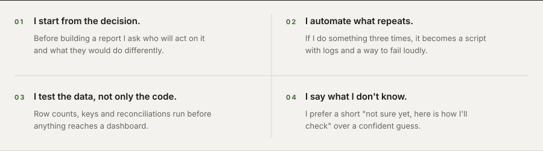
</picture>

## Contact

  <a href="https://linkedin.com/in/lksuey"><picture>
    <source media="(prefers-color-scheme: dark)" srcset="assets/btn-linkedin-dark.svg">
    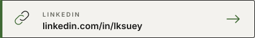
  </picture></a>
  <a href="mailto:Lucassoares8365@gmail.com"><picture>
    <source media="(prefers-color-scheme: dark)" srcset="assets/btn-email-dark.svg">
    
  </picture></a>

<picture>
  <source media="(prefers-color-scheme: dark)" srcset="assets/footer-dark.svg">
  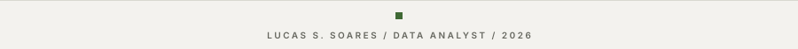
</picture>
